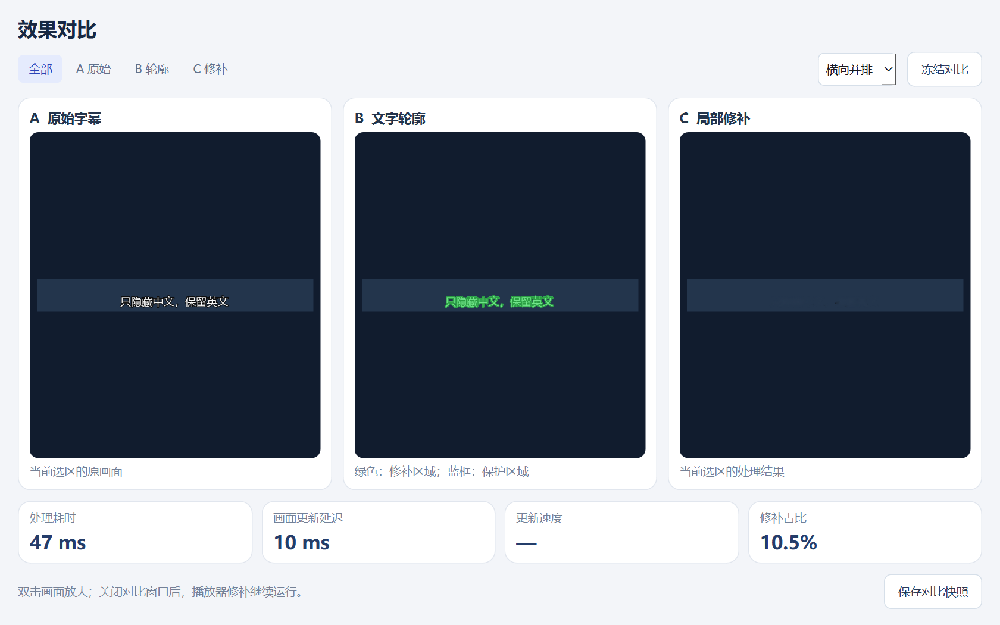

# 留英文 · Subtitle Eraser

Windows 桌面字幕局部修补工具，版本 **0.3.0**。在网页或客户端的原播放器中观看双语视频，框选中文字幕区域，尝试去除中文字形、保留英文和周围画面。

默认低延迟模式直接提取明亮笔画，再用 OpenCV 修补；“防止切换露字”持续显示处理后的中文选区，减少新字幕先露出再消失的现象。也提供可选的字幕样式校准、播放器设置记忆和后台 OCR 模式。

**当前是效果验证原型。** 已压进视频的字幕遮住了原始背景，修补只能估计背景。复杂纹理可能模糊、残留描边或误选；持续显示选区会让局部背景稍晚更新，快速运动时可能看到接缝。它不能保证无损还原或零露字。

## 界面预览

以下是程序生成的合成字幕样例，用于展示界面，不代表真实影片的修补效果。




## 环境要求

- 已验证环境：**Windows 11 x64**。Windows 10、独占全屏、HDR、受保护视频和画中画尚未完成兼容性验证。
- 源码运行使用 **Python 3.11** 和 [uv](https://docs.astral.sh/uv/getting-started/installation/)。安装脚本会创建独立环境并下载所需 Python 和依赖。
- 实时 OpenCV 路线使用 CPU，**不要求 NVIDIA 显卡**。可选的 ProPainter 离线研究另需兼容 CUDA 的 NVIDIA GPU、大量下载空间及独立环境。
- 主要适用于中英文分行、白色或黄色、带深色描边的字幕。其他明亮颜色可尝试样式校准。

## 开始使用

普通用户从仓库的 **Releases** 下载 `SubtitleEraser-0.3.0-Windows-x64.zip`，完整解压后直接启动。无需先安装 Python。更短的入门步骤见 [普通用户使用说明](docs/QUICK_START.md)。

### 使用便携版

如果拿到便携版 ZIP，请**完整解压**后打开 `SubtitleEraser.exe`，保留同目录的 `_internal` 文件夹；不要只复制 EXE。使用新版前退出其他正在运行的版本，避免叠加层重叠。源码仓库不包含预构建 EXE；自行生成便携版见下方[构建](#构建)。

### 连接播放器

1. 在原播放器打开双语字幕，先暂停在有中英文的一帧。
2. 打开“留英文”，选择目标窗口，点击“连接窗口”；列表中没有目标时恢复窗口并刷新。
3. 保持“低延迟 · 只框中文”和“防止切换露字”，点击“框选 / 重新校准”。上下包含完整中文及黑色描边，左右留出后续长句空间，**不要包含英文**。
4. 点击“使用此区域”，需要检查时点击主窗口右上角“查看效果 A / B / C”，在独立窗口查看原图、绿色文字轮廓和修补结果，再切回播放器继续观看。
5. 在全屏播放器中按界面底部显示的实际快捷键可直接框选（优先 `Ctrl+Alt+R`，被占用时自动改用 `Ctrl+Alt+Shift+R`），不必先切回主界面。如果打开框选窗口导致播放器退出全屏，确认后回到相同全屏画面，已保存的范围会恢复。
6. 按 `Ctrl+Alt+H` 切换原图与修补。窗口放大或切全屏时会自动重新定位；切换期间会短暂恢复原图。若提示无法定位，请在有字幕的一帧重新框选。

程序会尝试沿同一中文行的笔画补足左右漏出的部分，保持上下边界不动。无法辨别的背景、复杂排版或另一行文字不会因此自动处理。

低延迟模式不判断语言：框入英文时，英文也可能被处理。叠加只在目标窗口位于前台且尺寸匹配时出现；最小化、切到其他应用、窗口切换尚未完成或停止处理时隐藏。

全屏跟随适用于可捕获的普通/无边框窗口。切换时若恰好换字幕、切镜头，或网页字幕与视频分别缩放，自动匹配可能失败。程序不会把旧选区强行拉满新窗口；重新框选后会记住本次连接中的布局。另开全屏窗口仅自动跟随同一进程；独占全屏与不同进程的播放器需要重新连接或改用无边框模式。

“体验动态样例”使用程序生成的素材；“打开本地视频”用于循环对比预览，不修改源文件。“保存对比快照”在你选择保存位置后输出截图和耗时记录。

## 控制与效果对比窗口

主窗口集中显示连接、框选、原图切换和停止。字体颜色、边缘修补、样式校准、保存与恢复播放器设置位于“高级设置”，默认收起；屏幕空间不足时可滚动查看。

点击右上角“查看效果 A / B / C”打开独立对比窗口。默认三栏并排，可改为纵向排列，或点击 A/B/C 标签单图放大；双击画面可在单图与三栏之间切换。画面始终按比例完整显示。对比窗口可独立调整大小或移到另一块屏幕。

“冻结对比”只固定预览画面，播放器修补和性能统计继续更新；冻结后仍可切换 A/B/C，保存快照导出冻结的同一帧。关闭或最小化对比窗口后停止预览刷新，实时修补继续运行。打开动态样例和本地视频时会自动打开对比。

## 样式校准与设置记忆

**可选校准：**框选后点击“校准字幕样式”，在当前中文的明亮笔画内部点一下，检查绿色轮廓与修补预览，再应用。程序只在点击时采样，播放中复用颜色和可靠时估计的字高，不增加逐帧 OCR。暗点、大块亮背景或不可靠采样会被拒绝。

校准不能区分同色背景纹理，也不是语言识别。换颜色、字体或视频后应重新校准；可随时“恢复默认样式”。调整“边缘修补”会保留采样，选择预设颜色、重新框选、更换来源或切换处理方式会清除采样。

**保存设置：**连接播放器并框选后点击“保存设置”，记录区域、模式、颜色样式、边缘范围和防露字开关。下次连接同一播放器，点击“恢复设置”，在当前画面确认范围后应用。尺寸不符时要求重新框选。每个播放器程序只保存一份配置，同一浏览器的不同网站共用这份记录。

## 处理方式与取舍

| 方式 | 适用范围 | 主要限制 |
| --- | --- | --- |
| 低延迟 · 只框中文 | 中文位置固定，用户能排除英文 | 不判断框内语言；亮纹理可能误选，位置变化需重新框选 |
| 防止切换露字 | 低延迟模式下减少换句时的原文透出 | 显示整个处理后选区，背景也有时差；快速运动可能有边界 |
| 自动区分中英文 | 框选双语区域，通过后台 OCR 找中文 | 首次定位和排版变化需要等待；混排或低置信度区域保留原图 |

防露字解决的是显示时序，不提高字形识别准确率。首次处理尚未完成、漏检、框外字幕、处理失败时仍可能露字。取消该选项后，覆盖层仅显示修补字形，背景时差范围变小，但换句时更容易短暂透出新字。

## 数据与隐私

- 窗口采集、文字识别和修补在本机执行，不提供上传视频、云推理、遥测或账户登录功能。
- 捕获绑定所选窗口，并可跟随同一进程的前台全屏窗口；应用处理该窗口的画面，然后裁出用户选区。帧和校准截图通常只保留在内存，**点击保存快照时才导出图像**。
- 点击“保存设置”后写入 `%LOCALAPPDATA%\SubtitleEraser\profiles.json`，内容为播放器程序名、程序身份哈希和数值设置，不含截图、窗口标题、网址或完整程序路径。
- 便携版启动错误记录在 `%LOCALAPPDATA%\SubtitleEraser\runtime.log`。异常信息可能包含本地路径，提交问题前请检查并删去私人信息。
- 安装依赖和设置 ProPainter 研究环境需要联网下载；这与正常观看时的本地处理分开。

## 验证与已知表现

0.2.2 增加了黑色描边随视频放大、左右漏字、全屏直接框选及框选期间改变尺寸的回归检查；本机源码测试与便携版自检均使用随附的 Noto 字体。只检出源码、尚未构建便携版时，打包相关测试会跳过。具体覆盖范围、复现命令和测量口径见 [验证说明](docs/VALIDATION.md)。

以下是六场景合成素材、每种分辨率 288 帧的校准对比。表中时间只含中文选区的轮廓提取与 OpenCV 修补，**不包含屏幕采集、界面更新和显示器延迟**。

| 源画面 / 中文选区 | 默认处理 P50 | 校准后 P50 | 校准后字形覆盖率 |
| --- | ---: | ---: | ---: |
| 960×540 / 768×91 | 10.40 ms | 10.14 ms | 99.23% |
| 1440×810 / 1152×138 | 21.48 ms | 19.96 ms | 99.36% |

在这组素材中，校准后的覆盖率比默认规则略低，不能据此声称校准改善了自然度。英文位于选区之外，两种模式均未改动英文或掩膜外像素。真实网站、真人画面、任意字体和快速运动仍需要人工试用；测试视频按原始帧率回放，不是实时运行录像。

## 开发与测试

### 运行源码

下载或检出本仓库，进入项目目录，安装 uv 后运行：

```powershell
.\setup.cmd
.\start.cmd
```

`setup.cmd` 按锁文件安装依赖到 `.venv`，不修改系统 Python。首次安装需要联网；模型随依赖安装后，正常字幕处理在本地完成。此项目可以独立运行，不依赖 Unity。

需要在终端查看错误时运行：

```powershell
.\.venv\Scripts\python.exe -m subtitle_eraser
```


完成 `setup.cmd` 后运行：

```powershell
.\.venv\Scripts\python.exe -m pytest -q
.\.venv\Scripts\python.exe -m subtitle_eraser --self-test
```

生成动态对比和校准指标：

```powershell
.\validate.cmd
.\.venv\Scripts\python.exe tools\calibration_benchmark.py
```

生成物写入 `outputs/`，默认不提交到仓库。更多测量方法见 [验证说明](docs/VALIDATION.md)，代码分工见 [架构说明](docs/ARCHITECTURE.md)，贡献流程见 [CONTRIBUTING.md](CONTRIBUTING.md)。

## 构建

在完成源码环境安装的 Windows 机器上运行：

```powershell
.\build.cmd
```

构建脚本使用固定版本 PyInstaller 和仓库中的 `SubtitleEraser.spec`，默认输出到 `dist-calibrated/SubtitleEraser/`。完整目录才是便携应用；构建生成物不应直接提交到 Git。打包检查应确认 EXE 能从其他工作目录启动，详见 [发布前验证](docs/VALIDATION.md#发布前验证)。

打包配置会排除构建机其他工具带入的同名 ICU 库，避免 Qt 出现“DLL load failed / 找不到指定的程序”。不要通过从其他程序目录复制同名 DLL 来修补发行包。

## 可选：ProPainter 离线研究

ProPainter 用于比较短片段背景修补效果，**没有接入实时覆盖层**。这条路线需要独立 `.research-venv`、CUDA GPU、官方源码与权重下载；普通使用不需要安装。

先完成 `setup.cmd` 和 `validate.cmd`，再运行：

```powershell
.\setup-research.cmd
.\research.cmd
```

研究脚本固定 ProPainter 源码版本，下载清单记录大小和 SHA-256；实验使用相同掩膜，并在输出时强制保留掩膜外原像素。研究环境的部分依赖未完整锁定，环境版本需随结果记录。三段合成片段的既有实验未显示 ProPainter 稳定优于 OpenCV，耗时也不适合当前实时路线。

## 许可

本项目源码采用 [MIT 许可证](LICENSE)。第三方库、OCR 模型、字体及可选 ProPainter 使用各自许可证，详见 [THIRD_PARTY.md](THIRD_PARTY.md)。项目的 MIT 许可不会替代这些组件的分发和使用条件；ProPainter 不包含在实时桌面发行包中。

## 发布到 GitHub

源码仓库与二进制附件的整理方式见 [发布指南](docs/PUBLISHING.md)。Windows 工作流会测试并生成带对应源码的发布附件；没有自动创建公开 Release，也没有预设远程仓库。工作流交付时尚未在你的 GitHub 账号执行。

### 全屏快捷键没有反应时

先看主界面底部显示的是哪个组合键。如果 Ctrl+Alt+R 已被其他程序占用，0.2.3 会自动尝试 Ctrl+Alt+Shift+R，并显示实际启用的组合键。程序不会抢占其他应用的快捷键。收到按键但未取得当前全屏画面时，会显示置顶提示，不再无声退出。

自动跟随要求同一进程的窗口；显式按下框选快捷键，还可以重新连接同一播放器程序的当前全屏窗口。播放器已经退出、受保护而不可捕获，或两种快捷键都被占用时，需要重新连接或使用框选按钮。
