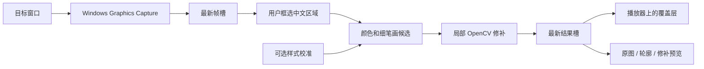

# 架构说明

本项目是独立 Windows 桌面应用。Python 负责窗口选择、配置和处理调度；PySide6 显示控制界面与覆盖层；Windows Graphics Capture 提供目标窗口画面；OpenCV 提取文字候选并修补背景。

## 数据流

实时默认路径不调用 OCR。选择自动模式时，框选范围可以包含中英文；独立识别线程提供中文允许区域和英文保护区域，再进入同一字形与修补过程。

## 模块职责

| 模块 | 职责 |
| --- | --- |
| `subtitle_eraser/windows.py` | 窗口枚举、程序身份、前台判断、物理像素位置、捕获排除标记和全局快捷键 |
| `subtitle_eraser/capture.py` | WGC 目标窗口捕获、原生缓冲区复制、只保留最新帧、等待新帧 |
| `subtitle_eraser/worker.py` | 处理线程、选区绑定、设置代次、最新处理结果、合并界面唤醒 |
| `subtitle_eraser/pipeline.py` | 可选 OCR、允许和保护区域、字形掩膜、局部修补、耗时记录 |
| `subtitle_eraser/style.py` | 明亮笔画点击采样、颜色候选范围、保守字高估计、样式校验 |
| `subtitle_eraser/presentation.py` | 将完整处理结果变成带透明度的覆盖层图像 |
| `subtitle_eraser/profiles.py` | 播放器配置验证、身份哈希、尺寸检查和本地原子写入 |
| `subtitle_eraser/ui.py` | 源选择、框选与校准、设置恢复确认、预览和覆盖层生命周期 |
| `subtitle_eraser/fixtures.py` | 可重复合成素材、干净背景、中文字形真值 |
| `subtitle_eraser/validate.py` | 自动模式离线基线、动态对比与报告 |
| `subtitle_eraser/propainter.py` | 独立研究环境下的短片段推理、测量与对比 |

## 字形处理

1. 手动模式把中文选区作为允许范围；自动模式从识别框生成允许范围，并使英文、混排和低置信度保护区域优先。
2. 默认使用白色或黄色候选；校准时改为保存的色相、饱和度和亮度范围。
3. 通过形态学 top-hat 提取细亮笔画，按连通组件形状筛选，再加少量边缘覆盖描边或阴影。
4. 掩膜过密时判为不可靠；未找到字形时保留原图，不退回整条黑带。
5. 只对包含掩膜的局部图像执行 Telea 修补，最终仅将掩膜内像素合成回当前帧。掩膜外像素保持逐像素相同。

掩膜正确不代表估计的背景自然。修补可能模糊、纹理方向不连续，错误候选也可能伤及画面。校准只提供颜色与尺度线索，不能辨认“这是字幕”或“这是衣服”。

## 校准与配置

校准从一个明确的笔画点击开始，仅使用点击周围的小邻域采色。暗点、大块高亮区域和缺少局部对比的区域会被拒绝。只有多个同排、尺寸相近的候选支持时才估计字高；否则保存 `None`，沿用保守的尺度计算。序列化只包含数值字段。

配置按播放器程序身份哈希索引，保存程序名、画面尺寸、归一化选区和用户设置，不保存画面、视频网址或窗口标题。恢复要求尺寸一致，界面仍先展示当前画面供用户确认。同一浏览器的多个网站不会自动分成多个配置。

读写使用严格字段、范围、大小和版本检查。损坏或未知格式不会静默覆盖。写入先在目标目录产生临时文件，再替换最终文件。

## 延迟与线程

捕获回调在原生缓冲区被复用前复制图像，只替换最新帧槽。工作线程使用最新帧，不建立无界队列。处理结果也只有最新一份；界面通知至多挂起一条，消费通知后读取最新结果。

选区或设置变化会增加代次。旧代次结果不得更新覆盖层；窗口尺寸变化使旧结果失效，再进入限时重定位；本次连接中已验证的窗口/尺寸布局可恢复。静止捕获画面可按较低频率重新处理，以便设置或后台识别结果生效。

自动模式 OCR 同时最多运行一项任务，语言识别不会阻塞每帧修补。缓存有时限，镜头切换、范围或模式变化会使旧结果失效。手动模式不因切镜重新等待 OCR。

控制窗口和对比窗口分别管理布局。对比图最多每秒刷新 10 次，关闭、最小化或冻结时不生成预览；控制窗口最小化不会影响独立对比刷新。单图模式只转换可见的一幅图；打开窗口、切换布局和解冻时立即读取当前最新结果。冻结保留同一帧用于切换三幅画面和导出，不暂停处理线程或覆盖层。界面中的“画面更新延迟”只测采集回调之后的部分链路，不含捕获前等待和显示器扫描。

## 覆盖层的两种呈现

**字形覆盖：**透明度等于当前修补掩膜。掩膜外直接露出播放器画面，但底层先换句、处理结果后到达时，新文字可能从旧掩膜空隙透出。

**防止切换露字：**显示整张已处理中文选区，透明度全为 255。新结果完整准备好后替换旧结果；不额外缓存整个视频。这样阻断等待期间的底层原文透出，但选区背景也比周围画面稍晚，快速运动和切镜可能出现接缝。

这里保留的是上一张完整处理结果，算法没有把上一帧人物或纹理混入当前帧修补。二者是呈现时序与背景修补的不同问题。

覆盖层点击穿透、不获取焦点，并设置捕获排除标记。窗口句柄、尺寸、前台状态和结果有效性不满足条件时隐藏。选择模式、重新框选和更换来源会使旧配置或结果失效；程序不会自动改用黑色遮挡。

## 运行数据与构建边界

运行时主要数据是内存中的窗口帧、选区结果和样式采样。主动保存的配置在 `%LOCALAPPDATA%\SubtitleEraser`；主动导出的对比图由用户选择位置。开发与研究结果写入项目 `outputs/`，不纳入默认源码提交。

PyInstaller 使用仓库中的 `SubtitleEraser.spec`。Qt、OCR 模型与原生依赖属于便携版；ProPainter 源码、权重和研究环境不属于实时发行包。构建时排除来自其他工具的同名 ICU DLL，使用目标 Windows 环境提供的对应库。发布验证必须实际运行打包后的 EXE，而非只测试源码导入。

## 窗口坐标与全屏切换（0.2.1）

覆盖层首次显示前先设置 Qt 逻辑几何，再执行原生定位。仅在隐藏时调用 SetWindowPos 不会同步 QWidget 尺寸，随后 show 会恢复默认 640×480 逻辑像素，这是旧版巨大拉伸画块的原因。分数缩放率下保留至多 1 个物理像素的取整误差；原生回归检查读取真正显示后的 HWND 边界。

重定位仅在布局变化时运行 SIFT/RANSAC，要求选区内字幕本身有足够匹配、边缘一致，且变换接近等比缩放和平移。不能仅凭背景移动决定字幕位置，不直接按整个窗口比例缩放。最多尝试 6 秒，失败后明确提示重选；期间不展示旧修补层。日常逐帧手动处理不调用 OCR 或特征匹配。字高校准随实际选区比例调整，返回原布局时不会累积比例误差。

播放器前台窗口改变时，仅接受原窗口或同一进程的全屏窗口，不按标题猜测其他应用。画面大小持续与窗口不符超过 300ms 时重建采集，限制重试次数。所有重定位、重新采集和用户重新框选均使旧代次结果失效。布局缓存最多 6 项，仅在本次连接的内存中保存坐标，不额外持久化图像。

## 全屏中文选区与描边（0.2.2）

`Ctrl+Alt+R` 以按键时采集到的画面打开置顶框选对话框。确认结果绑定截图的窗口/尺寸键，立即写入本次连接的内存布局缓存；若对话框令播放器改尺寸，不把旧图选区套到新尺寸，也不丢弃选择，回到相同布局时恢复。校准取色仍要求对应帧有效。

`row_extent.py` 在当前上下边界内，以多个同排笔画建立文字簇，只沿相邻笔画横向扩展，不向远处亮物体跳跃，不上下扩大。短小横笔画不能建立文字簇，但可补足已有簇的边缘。手动模式仍依赖用户排除英文。

处理设置含不持久化的 `processing_scale`，由当前/参考选区的物理高度计算，不与取色校准绑定。大字幕先在较小工作尺寸上修补，再映射掩膜并回填；全分辨率掩膜外像素保持逐位不变。新增的重采样边缘余量只用于放大路径。直接全屏框选时，根据字高与超出普通 3px 范围的中性深色边缘判断是否使用大字幕路径，避免仅因字号大而过度扩张细描边。

密集候选保护同时检查白色/彩色核心占比和最终掩膜占比；合法紧框中文行不能仅因为描边扩张后超过 68% 就被完全取消。覆盖层每半秒在前台目标窗口上重新置顶一次，不重设尺寸、不抢焦点。
